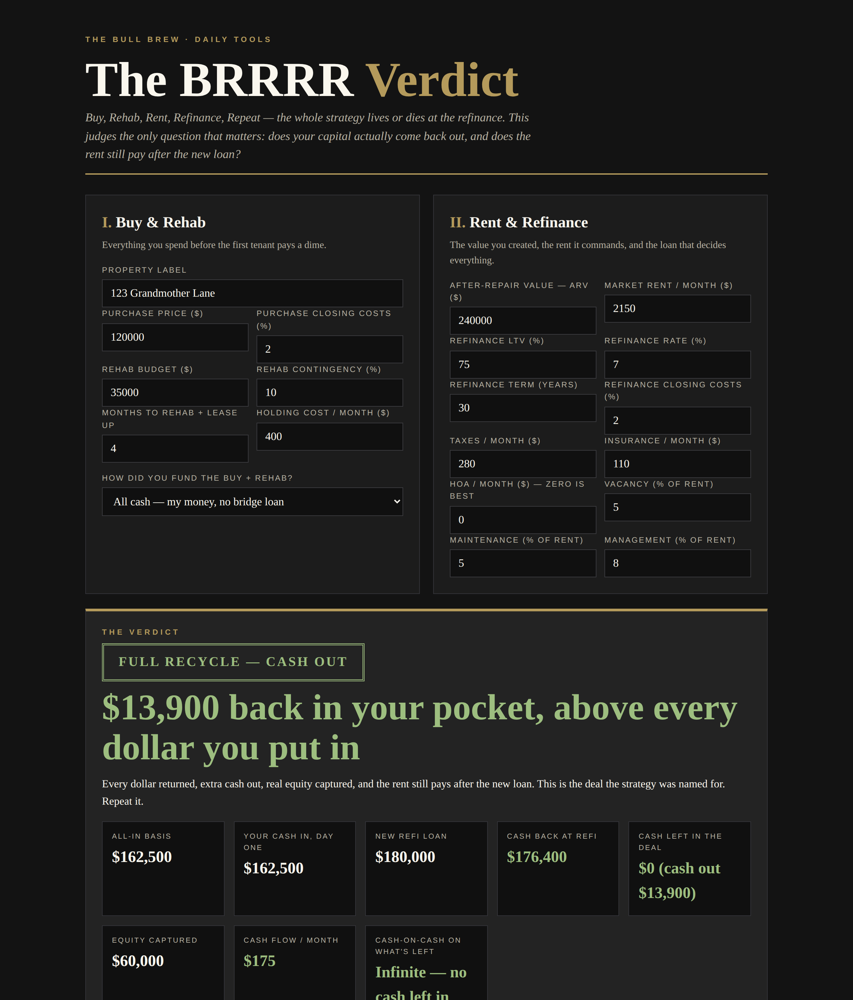

# The BRRRR Verdict

**Live:** https://thebullbrew.github.io/brrrr-verdict/

Buy, Rehab, Rent, Refinance, Repeat — the whole strategy lives or dies at the refinance. This tool judges the only question that matters: does your capital actually come back out, and does the rent still pay after the new loan?

## What it does

- **Full recycle math** — all-in basis (purchase + closing + rehab with contingency + holding costs), optional hard-money funding (coverage %, interest-only rate, points, fees), refinance proceeds net of closing costs and bridge-loan payoff, and the one number most spreadsheets hide: **cash left in the deal**.
- **Seal verdicts** — FULL RECYCLE (cash out + real cash flow), CAPITAL RETURNED — THIN RENT, CLEAN BRRRR, TRAPPED CASH, and TRAPPED & BLEEDING, judged on cash left, post-refi cash flow, and equity captured in that order.
- **Honest cash-on-cash** — calculated on the cash actually left in the deal after the refinance, not the cash you started with. Zero left means the return is infinite, and the tool says so.
- **Appraisal sensitivity** — cash left, cash flow, and CoC if the ARV lands −20% to +20% (the most common way a BRRRR quietly traps capital).
- **LTV table + required LTV solver** — what 65–80% LTV each leaves behind, and the exact loan-to-value you'd need for a full recycle, flagged when it's beyond standard investment-refi limits.
- **Saveable deals** (localStorage), copyable summary, works fully offline as a PWA.

## The method behind it

A BRRRR only repeats if the refinance returns your capital. Judge every deal on three numbers, in this order: cash left in the deal, cash flow after the new loan, equity captured. A deal that leaves $40k trapped and rents for $90 a month is not a strategy — it's a slow savings account with a roof. No HOA if you can help it; dues eat the recycle.

Design: dark old-money variation 15 (Iron & Ivory) — ivory-forward headlines, gold reserved for numbers and rules, rivet-dot dividers.

## How to run

Open `docs/index.html` in any browser, or serve the `docs/` folder with any static host. No build step, no backend, no accounts. Everything runs on your device.

*Estimates only — not financial advice. Built by [The Bull Brew](https://thebullbrew.com) · One useful tool, every day.*
